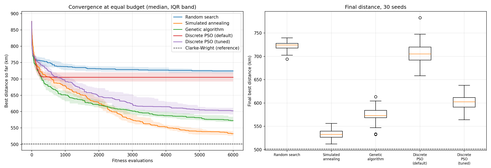
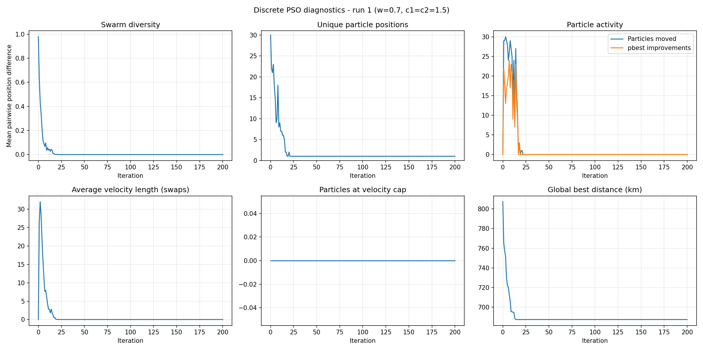

# CVRP Route Optimization: Discrete PSO vs. Metaheuristics

Capacitated vehicle routing for Indomaret Storesin Jakarta Utara (45 customers, 1 depot), using real road distances from the OpenRouteService API. A discrete Particle Swarm Optimization (PSO) is implemented from scratch, diagnosed, tuned, and benchmarked against simulated annealing, a genetic algorithm, random search and the Clarke-Wright savings heuristic at an equal evaluation budget.

## Problem
- 45 customers + 1 depot, driving distances from the OpenRouteService `driving-car` matrix (asymmetric)
- Customer demands are **synthetic**: uniform integers in [10, 49] (seed 42), total demand 1,364
- Vehicle capacity 100, so at least 14 vehicles are needed
- Objective: minimize total travelled distance (vehicle count is reported, not optimized)
- Encoding: a permutation of customers, decoded into routes by a greedy capacity split

## Method
- **Discrete PSO:** positions are permutations, velocities are sequences of swap operations (inertia, cognitive and social components)
- **Diagnostics:** swarm diversity, unique positions, particle activity, velocity length and stagnation
- **Tuning:** grid over `w`, `c1`, `c2`, then confirmation of the top 3 on extra seeds, then swarm-size study, all at a fixed budget of 6,000 fitness evaluations
- **Comparison:** 30 fresh seeds per algorithm (disjoint from tuning seeds), Mann-Whitney U tests with Holm correction

## Results (mean total distance, 30 runs, 6,000 evaluations each)

| Method | Mean (km) | Std (km) | Best (km) |
|---|---|---|---|
| Simulated annealing | 532.7 | 11.7 | 512.3 |
| Genetic algorithm | 574.9 | 18.6 | 532.5 |
| Discrete PSO (tuned) | 601.9 | 17.1 | 564.2 |
| Discrete PSO (default) | 707.5 | 25.2 | 658.3 |
| Random search | 723.1 | 10.4 | 694.3 |
| Clarke-Wright savings (deterministic reference) | 501.2 | n/a | n/a |

Tuned PSO configuration: 50 particles, w = 0.9, c1 = 1.5, c2 = 0.5.

### Key findings
- **Default PSO converged prematurely.** Swarm diversity fell to zero within about 10 iterations and over 93% of later iterations produced no improvement, so it performed close to random search.
- **Tuning helped substantially.** Mean distance fell about 15% (708 to 602 km), and the improvement is statistically significant.
- **PSO did not beat the alternatives.** Simulated annealing and the genetic algorithm were significantly better than tuned PSO, and Clarke-Wright savings was the best overall.
- **Distance data is consistent.** The matrix distances used by the optimizer match the route-level ORS directions distances (difference under 0.01%).

## Route visualization
Interactive Folium maps with road-level geometry were generated for the best tuned-PSO solution and the best random-search solution.

<!-- Add screenshots, e.g.  -->

## Limitations
- Demands are synthetic, and results come from a single problem instance
- The greedy split decoder restricts the search space; an optimal split (Prins) or local search such as 2-opt would likely help all methods
- Total distance only: no time windows, no vehicle-count penalty
- The ORS matrix is a single snapshot of the road network

## Reproducing
1. Open the notebook in Google Colab.
2. Add two secrets in Colab (key icon, enable notebook access):
   - `ORS_API_KEY`: free key from https://openrouteservice.org
   - `carto_API_key`: free key from https://carto.com/basemaps/apikey (only needed for map tiles; the notebook falls back to OpenStreetMap without it)
3. Provide the location CSV (`LocIDMJakut.csv`) and run all cells.

## Repository contents
- `Vehicle_Routing_Problem_IDM_Jakut.ipynb`: full pipeline (data, ORS matrix, CVRP, PSO, diagnostics, tuning, comparison, maps)
- `results/`: figures, summary tables and `RESULTS.md` with all experiment details

## Tools
Python, NumPy, pandas, SciPy, Matplotlib, Folium, OpenRouteService API
